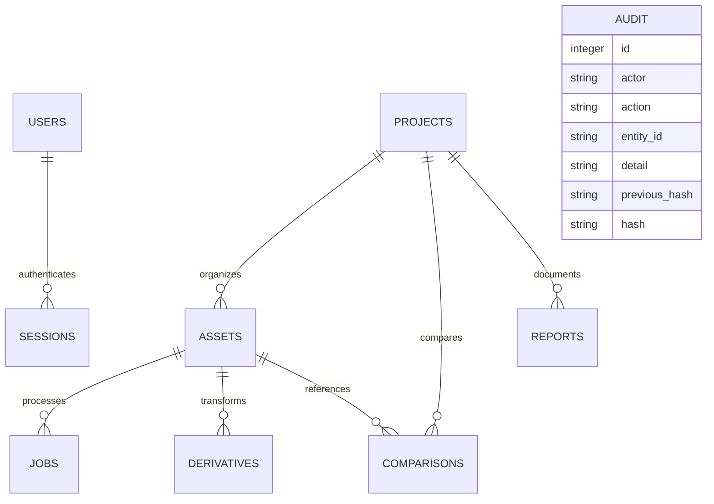
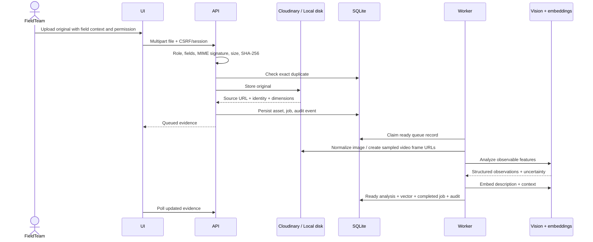

# Architecture and engineering decisions

## Scope

ImpactLens implements the complete PS 02 field-evidence workflow as a single-instance, single-workspace application. It is designed to be easy to run locally, demonstrate honestly, and extend. It does not claim multi-tenant production readiness or verified environmental impact from pixels alone.

## Components

| Component            | Technology                              | Reason                                                                                |
| -------------------- | --------------------------------------- | ------------------------------------------------------------------------------------- |
| User interface       | React 19 + TypeScript                   | Typed evidence objects, forms, state and reusable views                               |
| Build                | Vite                                    | Fast local iteration and compact static production output                             |
| API                  | Express 5                               | Async routes and clear upload/review/report boundaries                                |
| Validation           | Zod                                     | Shared explicit constraints for inputs and AI response structures                     |
| Database             | Node 24 built-in SQLite                 | No extra database server; SQL constraints, WAL persistence and transactions available |
| Media pipeline       | Cloudinary Node SDK                     | Live storage, stable asset identity, optimized delivery and image/video transforms    |
| Local media fallback | Disk + Sharp                            | Credential-free runnable demo, image normalization and real campaign crops            |
| AI                   | Configurable OpenAI vision + embeddings | Qualitative image/frame understanding and meaning-based metadata retrieval            |
| Reports              | PDFKit                                  | Visual PDFs with original source citations and field measurements                     |
| Icons / styling      | Lucide + custom CSS                     | Purpose-specific responsive field workspace                                           |

## Data model

- `users`: salted scrypt password, normalized unique email, name and workspace role.
- `sessions`: hash of random session token, user, CSRF token and expiry.
- `projects`: purpose, location, focus area and visual color.
- `assets`: original filename and MIME, source/delivery identity, byte hash, dimensions/duration, project, user-supplied location/date/phase, notes, consent, lifecycle/review state, structured analysis and optional text embedding/model.
- `jobs`: durable queue record, attempts, availability time, status and sanitized service failure message.
- `comparisons`: explicit original baseline/follow-up references and qualitative result snapshot.
- `reports`: project, title, internal status and complete report JSON snapshot.
- `derivatives`: source asset, format preset, exact transformations and derivative URL.
- `audit`: linked event hashes; update/delete triggers enforce application-level append-only history.

The unique `(project_id, sha256)` constraint rejects exact same-project duplicates. It deliberately does not merge different crops or near duplicates. The same bytes may legitimately appear in different projects, but the upload context is separate.

## Upload lifecycle

No analysis is reported as successful merely because a file uploaded. The record moves through `queued → analyzing → ready`, or retries before `failed`. Review state is separate: `pending → approved|rejected`. Reanalysis resets review immediately.

## Jobs and retry semantics

The worker executes one job at a time in the API process. A polling loop selects an available queued job, marks it running, increments attempts and performs analysis. Transient errors schedule retry after 5 seconds and then 10 seconds. A third failure marks both job and asset failed. Service attempts use timeouts. Startup recovers running records to queued state; attempts remain recorded.

Embedding failure is treated separately: vision output can be useful without a vector. The asset becomes ready with an uncertainty message that indexing failed, and keyword search works. Reanalysis retries vision and indexing and therefore clears any previous review approval.

This is a single-worker design. It does not implement distributed leases, multi-instance queue coordination, webhook-driven processing, per-tenant fairness or bulk concurrency. At scale use a queue such as BullMQ plus Redis with idempotent jobs, bounded concurrency, leases, provider-aware backoff, quota controls and dead-letter handling.

## AI trust boundary

Images, image text, filenames, notes and metadata are untrusted evidence, never instructions. The system prompt requires observation-based qualitative summaries, explicit uncertainty, and no invented location, identity, impact measurements or causation. The application validates field types and lengths after JSON parsing. These controls reduce errors but do not eliminate model hallucination; human review remains required.

Semantic discovery embeds the text description rather than the image pixels. Text plus metadata captures meaning that keyword-only tags miss, while keyword matching retains exact terms. Hybrid score = `0.75 × positive cosine similarity + 0.25 × matched query-word fraction`. Results use a minimum score threshold. Vectors are used only when the stored model matches the configured embedding model. The similarity number must not be treated as evidence confidence.

Video coverage is explicitly limited to three sampled frames. Separate extraction/transcription and temporal analysis can be added for full video intelligence.

## Before-and-after reasoning

Pair validation requires two ready records, same project and strictly increasing capture dates. The reviewer should assess viewpoint, site alignment, season, weather, scale, lighting and camera changes. The AI can mark a pair non-comparable, and its observation list remains qualitative. A different apparent green area is not a measured increase in biomass or demonstrated project causation.

Pairs are saved with original UUID references. Reports include pairs only when both original records are selected as evidence. Image sliders use the originals; the slider itself is a visualization, not an analytical segmentation or registration model.

## Reports and campaign derivatives

Report construction verifies project membership, ready processing state, and human approval on the server. The narrative is assembled from reviewed context without inventing quantitative results. Measurements are entered by a reviewer, are nonnegative finite values, and must cite a selected real asset and method. The platform records these assertions rather than independently validating the field measurement.

The report snapshot retains the source state at generation. PDF previews are resized for presentation and linked back to the originals. Missing remote previews produce an explicit fallback notice. Publishing is internal status and rechecks current review readiness; illustrative media are prohibited. Draft exports may contain clearly labeled demo evidence.

Campaign transforms create square/story/landscape crops through Cloudinary or Sharp. Each derivative stores the source asset ID and parameters. A crop never replaces the original or becomes evidence without a separate source upload. Human review is required before campaign creation.

## Security and integrity

- HTTP-only SameSite=Strict cookies reduce client-side access to session tokens. Stored session tokens are SHA-256 hashes, not bearer values.
- Required CSRF tokens and write-origin allowlists protect state-changing endpoints. Role checks run server-side, independent of whether the UI hides a button.
- Server secrets are only loaded from environment configuration. Capability endpoints return booleans/model names, not keys.
- Upload caps, allowed MIME signatures, file-name isolation and Sharp pixel limits reduce upload risks. This does not replace antivirus scanning or content moderation in a public service.
- SQL values are parameterized. Query fragments are built only from fixed internal column mappings.
- CSV values are quoted and potentially executable leading characters are prefixed to mitigate spreadsheet formula execution.
- Helmet adds content/security headers. Local media require authentication. Public Cloudinary originals require a private-delivery extension for sensitive deployments.
- The audit chain proves consistency relative to the current stored head; it does not withstand an administrator replacing history and recomputing the chain. Anchor the head outside the database for stronger tamper evidence.
- Default demo credentials are explicitly for localhost. Live mode refuses the default password. Changing the bootstrap environment does not reset existing accounts.

## Deployment and scaling path

Start with one Node process, one SQLite database and a persistent disk. Serve the built SPA through the same Express process for consistent cookie/session behavior. Set the exact HTTPS application origin and secure cookies behind a reverse proxy. Back up database and media together.

For larger installations:

1. Move structured data to PostgreSQL, add organization/member ownership and enforce scoping on every route.
2. Move original storage fully to Cloudinary with authenticated delivery and signed access.
3. Use direct signed browser uploads with verified completion/webhooks for files larger than the current 25 MB cap.
4. Move jobs to a distributed queue and provide per-project progress, bounded retries and observable dead-letter records.
5. Move vectors to a dedicated index, add embedding version migrations, better hybrid retrieval and relevance evaluation.
6. Add calibrated change-analysis methods, camera alignment, survey metadata and validated field protocols before offering quantitative visual impact estimates.
7. Add SSO, password recovery, invitation expiry, organization isolation, consent retention, sensitive-media restrictions, monitoring and immutable audit anchoring.

These steps are documented extension points, not silently assumed capabilities of the local product.
